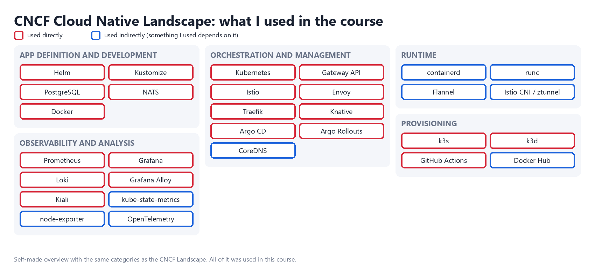

# CNCF Landscape (exercise 5.8)

The image is a self-made overview with the same categories as the CNCF Landscape. The official image is not available
at a fixed URL anymore, so I drew the projects I used instead of circling logos.

Colors:

- **Red border**: I used it directly.
- **Blue border**: I used it indirectly (something I used depends on it).

Everything I used is from this course. Nothing here is "outside of the course".

## Used directly (red)

- **Kubernetes**: all exercises, deploying and managing every application.
- **Docker**: building and pushing the images of all the apps (Docker Desktop and Docker Hub).
- **k3d**: creating the local clusters (parts 1 to 5); in 5.6 a new cluster without Traefik.
- **k3s**: the Kubernetes distribution inside k3d.
- **Helm**: installing NATS, Prometheus, Loki, Grafana and the monitoring stack in part 4.
- **Prometheus**: metrics in 2.10 and 4.3, and the analysis of the canary rollout in 4.4.
- **Grafana**: dashboards for the cluster metrics and logs in 2.10 and 3.12.
- **Loki**: storing and querying the logs of the apps in 2.10.
- **Grafana Alloy**: collecting the logs and metrics, installed with the k8s-monitoring chart.
- **NATS**: messages between todo-backend and the broadcaster in 4.6.
- **Argo CD**: GitOps deployment of log-output and of the project, staging and production in 4.7 to 4.10.
- **Argo Rollouts**: canary release of ping-pong with an AnalysisTemplate in 4.4.
- **Istio**: ambient service mesh, waypoint and Bookinfo in 5.2, and log-output with the greeter in 5.3.
- **Kiali**: seeing the Istio traffic graph in 5.2 and 5.3.
- **Knative**: Serving with Kourier and sslip.io in 5.6, and ping-pong as a Knative Service in 5.7.
- **Envoy**: Kourier and the Istio gateway and waypoint proxies are Envoy.
- **Traefik**: the ingress of the cluster in the earlier parts, before 5.6 removed it.
- **PostgreSQL**: database of todo-backend and ping-pong.
- **Kustomize**: base and overlays for staging and production in 4.9.
- **GitHub Actions**: CI that builds and publishes the images and updates the config repository in 3.x and 4.8 to 4.10.
- **Gateway API**: Gateway and HTTPRoute in 3.x, 5.2 and 5.3.

## Used indirectly (blue)

- **containerd**: the container runtime of k3s, so every pod ran on it.
- **runc**: containerd starts every container with it.
- **Flannel**: the network (CNI) of k3s; I have no idea how it works.
- **CoreDNS**: the DNS of every cluster, so service names such as `ping-pong-svc` and `greeter-svc` resolve.
- **Istio CNI and ztunnel**: the node-level parts of the ambient mesh in 5.2.
- **kube-state-metrics and node-exporter**: installed by the Prometheus chart.
- **OpenTelemetry**: Grafana Alloy is built on the OpenTelemetry Collector.
- **Docker Hub**: the registry where the images of the course were published and pulled from.
